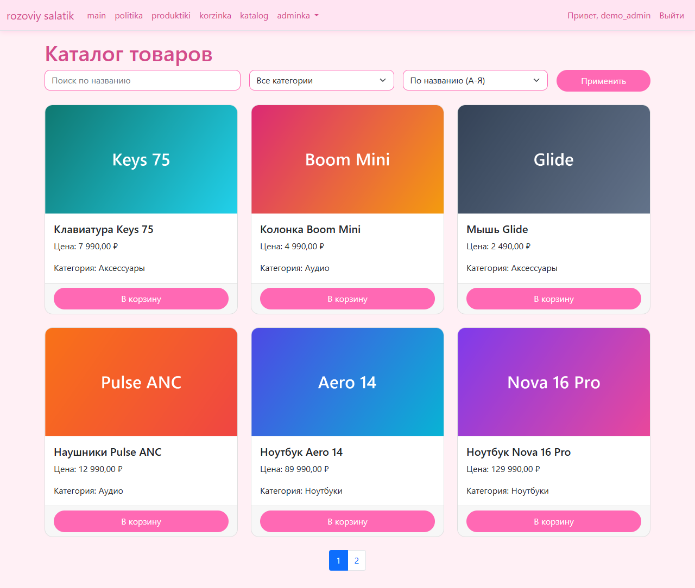
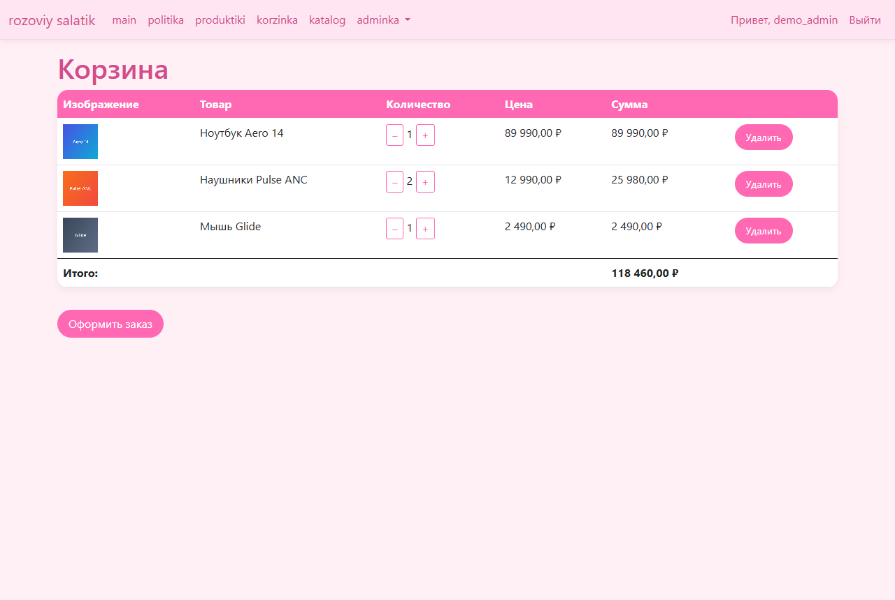
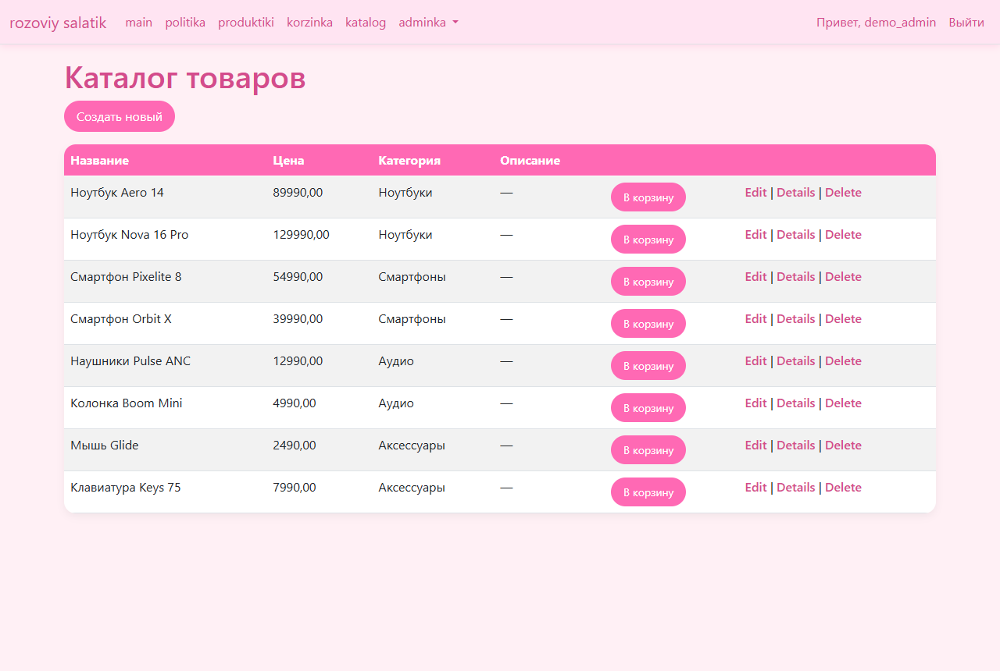

# aspnet-shop-mvc

Интернет-магазин на ASP.NET Core MVC · *Online shop on ASP.NET Core MVC*

`C#` `.NET 8` `ASP.NET Core MVC` `EF Core 9` `SQL Server` `BCrypt` `Bootstrap`

| Каталог · *Catalog* | Корзина · *Cart* |
|---|---|
|  |  |
| **Админка: товары · *Admin: products*** | |
|  | |

<sub>Скриншоты сделаны на демо-базе с выдуманными товарами · *Screenshots use a demo database with made-up products*</sub>

## Что сделано
- **Каталог** с поиском по названию, фильтром по категории, сортировкой (по имени и цене в обе стороны) и пагинацией по 6 товаров
- **Кэширование** списка категорий в `IMemoryCache` на 10 минут
- **Корзина:** добавление товара, изменение количества (+/−), удаление
- **Оформление заказа:** из корзины создаются `Order` и `OrderItem` с фиксацией цены, после чего корзина очищается
- **Регистрация и вход** на cookie-аутентификации: пароли хешируются BCrypt, роль пользователя передаётся в claims, сессия живёт 14 дней со скользящим продлением
- **Роли:** админ-разделы закрыты атрибутом `[Authorize(Roles = "Admin")]`, есть своя страница Access Denied
- **Админка:** CRUD для товаров, категорий, пользователей, ролей, заказов, позиций заказов, корзин
- **Загрузка изображений** товаров: файлы сохраняются в `wwwroot/images/products` под уникальными GUID-именами
- **Собственные атрибуты валидации:** `NoForbiddenWords`, `PricePositive`, `CategoryExists`, `EvenNumber`, `FutureDate`
- **Страницы ошибок:** своя 404 через `UseStatusCodePagesWithReExecute`

## Структура
```
WebApplication3/
├── Controllers/
│   ├── CatalogController.cs     # витрина: поиск, фильтр, сортировка, пагинация, кэш категорий
│   ├── CartController.cs        # корзина пользователя и оформление заказа
│   ├── AccountController.cs     # регистрация, вход, выход, Access Denied
│   ├── ProductsController.cs    # CRUD товаров + загрузка картинок (Admin)
│   └── Categories/Users/Roles/Orders/OrderItems/Carts/CartItemsController.cs  # CRUD (Admin)
├── Models/                      # сущности EF Core, ShopDbContext, Login/RegisterViewModel
├── ValidationAttributes/        # собственные атрибуты валидации
├── Views/                       # Razor-представления для каждого контроллера + _Layout
├── wwwroot/                     # стили, Bootstrap, картинки товаров
├── Program.cs                   # DI, EF Core, cookie-аутентификация, кэш, маршрутизация
└── appsettings.json             # строка подключения "con"
```

## Запуск
1. Укажи строку подключения `con` в `WebApplication3/appsettings.json` (по умолчанию `localhost\SQLEXPRESS`, БД `ShopDB`).
2. Запусти:
   ```bash
   dotnet run --project WebApplication3
   ```
   Или открой `WebApplication3.sln` в Visual Studio.

---

## English

An online shop built with ASP.NET Core MVC.

### Features
- **Catalog** with name search, category filter, sorting (name / price, both directions) and pagination (6 per page)
- **Caching**: the category list is kept in `IMemoryCache` for 10 minutes
- **Cart**: add products, change quantity (+/−), remove
- **Checkout**: creates an `Order` with `OrderItem`s (prices are fixed at order time) and empties the cart
- **Sign-up / sign-in** with cookie authentication: BCrypt password hashing, role in claims, 14-day sliding session
- **Roles**: admin sections are protected with `[Authorize(Roles = "Admin")]`; custom Access Denied page
- **Admin panel**: CRUD for products, categories, users, roles, orders, order items, carts
- **Product image upload** to `wwwroot/images/products` with unique GUID file names
- **Custom validation attributes**: `NoForbiddenWords`, `PricePositive`, `CategoryExists`, `EvenNumber`, `FutureDate`
- **Error pages**: custom 404 via `UseStatusCodePagesWithReExecute`

### Structure
```
WebApplication3/
├── Controllers/          # Catalog, Cart, Account, Products (+ image upload) and admin CRUD controllers
├── Models/               # EF Core entities, ShopDbContext, view models
├── ValidationAttributes/ # custom validation attributes
├── Views/                # Razor views + _Layout
├── wwwroot/              # CSS, Bootstrap, product images
├── Program.cs            # DI, EF Core, cookie auth, cache, routing
└── appsettings.json      # "con" connection string
```

### Run
1. Set the `con` connection string in `WebApplication3/appsettings.json` (default `localhost\SQLEXPRESS`, database `ShopDB`).
2. `dotnet run --project WebApplication3`, or open `WebApplication3.sln` in Visual Studio.
